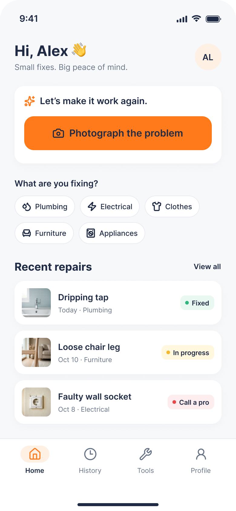

# Fix It Myself 🔧

AI-powered DIY repair assistant. Take a photo of what's broken,
and get a diagnosis, a tools list, and a safe step-by-step plan.

> ⚠️ Work in progress — university project (semester 1).

## Design
[Figma prototype](https://www.figma.com/proto/n4K76xh5dv2XX5AW53kKKp/Fix-It-Myself?node-id=4-2346&t=W2eOICEiXRXrf8ek-0&scaling=min-zoom&content-scaling=fixed&page-id=0%3A1)

## Planned features
- [ ] Photo diagnosis with AI
- [ ] Step-by-step repair instructions
- [ ] Risk warnings ("call a professional")
- [ ] Repair history
- [ ] My tools: plans adapted to what you own

## Tech stack
React Native (Expo), TypeScript, Node.js backend, multimodal AI API

## Roadmap
- [x] UI/UX design in Figma
- [ ] App skeleton and navigation
- [ ] Screens with mock data
- [ ] Backend + AI integration
- [ ] Polish and release
